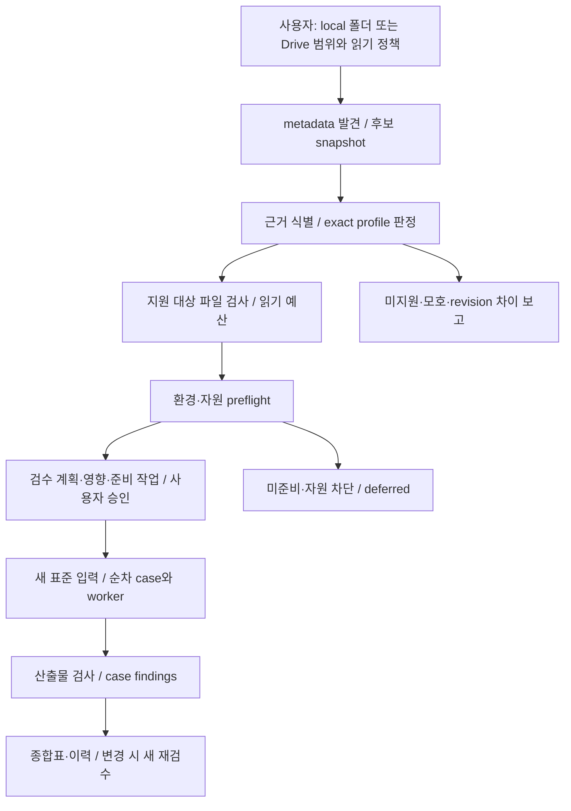

# 보유 모델 자동 검수 프로그램 — M11 이후 설계

## M12 제어 구현 checkpoint

[M12 보고서](M12_REPORT.md)에 실제 local 원본 metadata·새 read-only OAuth/Drive 관찰과 영속 승인·순차 CPU 조정기 검증을 구분해 기록한다. 지원 metadata 후보는 full artifact/revision·모델 정상 작동 PASS가 아니다. partial Drive·깊이 밖 관찰 제한, 미구현 모델 adapter/M13 fixtures·receipt, M14 UI와 M15 부분 재개를 남긴다. 후속 사람 참고 공수는 약23–38인일이며 이전 설계·M11 공수와 역사를 보존한다.

## M11 계약 원형 checkpoint

후속 source-only M11에서 6개 pinned catalogue·상태/전이·immutable plan/snapshot·dry-run 승인·입력 계보 선언과 stdlib CLI를 구현했다. [M11 보고서](M11_REPORT.md)·[원형 계약](M11_CONTRACT.md)을 따른다. 아래 ‘신규 기능 구현 전’과 최초 28–46인일은 설계 당시 범위로 보존하며, 이번 원형은 실제 discovery/설치/worker/receipt/사용자 인증·영속 승인 소비를 구현한 것이 아니다. 후속 참고 공수는 약 26–43인일이며 AI 시간/납기 약속이 아니다.

기준일: 2026-10-18. 상태: **설계·마일스톤 재정렬. 이 문서의 신규 기능은 구현·실행 검증 전이다.** 기준 main은 `57a65e7af85bfd9416c2bf005804cbade16e385b`, 기존 v0.10.0 Release/tag 소스는 `5a336cd0522fadda68f179ed4b8c5b0d4059aa5f`다. 이 설계 문서 반영으로 기존 패키지·태그·asset을 변경하지 않는다.

## 1. 제품 목표와 완료의 의미

사용자는 **로컬 모델 폴더를 지정하거나 읽기 전용 저장소 접근 범위를 제공**한다. 프로그램은 허용 범위 안에서 후보 발견 → 근거 기반 식별 → 지원 프로필/revision 판정 → 파일 검사 → 환경/자원 판단 → 검수 계획·승인 → 새 표준 시험 입력 → 순차 worker 실행 → 산출물 검사 → 모델별 종합표까지 연결한다. 입력·모델·환경이 바뀌면 필요한 검수를 새 job으로 다시 수행한다.

핵심은 모델의 정상 작동을 확인하는 **검수 조정 프로그램**이다. 자연어 Llama 비서, 파일 정리·삭제 agent, 임의 모델 코드 실행, 무제한 저장소 순회는 본 목표가 아니다. 지원하지 않는 모델도 자동 실행하는 범용 프로그램으로 약속하지 않는다.

‘검수 성공’은 **기록한 프로필·revision·환경·새 시험 입력에서 실제 실행이 끝나고 출력 계약을 통과**했다는 뜻이다. 음질·전사 정확도·이미지 미감·대답 유용성·일반 추적 품질의 우수성은 별도다. 검수 불가/환경 차단은 모델 고장 판정이 아니며, 모든 모델·모든 PC 정상 작동을 보장하지 않는다.

### 기존 이력과의 관계

최초 [PLAN](https://github.com/castle923/Ai-manager/blob/6acabecd37aedef2b6e09842ed90c4f6849c0b6f/docs/PLAN.md#L15)은 TTS 중심 수동 선택 MVP, [PIPELINE](https://github.com/castle923/Ai-manager/blob/6acabecd37aedef2b6e09842ed90c4f6849c0b6f/docs/PIPELINE.md#L9)은 사용자 선택·요청을 포함했다. M0–M10의 승인·구현·실측은 그 당시 범위로 보존한다. 이번 설계는 사용자 정정 의도에 맞게 **그 부품들을 자동 검수 흐름으로 연결하는 후속 범위**다. 과거 완료를 취소하거나 과거 성공을 새 workflow 성공으로 대체하지 않는다.

## 2. 지원 범위: 고정 6개 프로필

프로필은 임의 검색 결과가 아닌 현재 공개 소스의 manifest/lock/worker 계약을 기반으로 한다. 이름·폴더명만 일치하면 지원으로 판정하지 않는다. 같은 모델 계열이라도 아래 revision과 다르면 우선 `profile_revision_mismatch` 또는 `ambiguous`로 남기고 자동 실행하지 않는다.

| 프로필 ID | 공식 대상 | 고정 revision | 필수 파일/bytes | 기본 시험 |
|---|---|---|---:|---|
| `qwen3-tts-0.6b-customvoice` | Qwen/Qwen3-TTS-12Hz-0.6B-CustomVoice | `85e237c12c027371202489a0ec509ded67b5e4b5` | 13 / 2,498,388,392 | 새 한국어 문장·현재 bounded TTS recipe·WAV |
| `qwen3-tts-1.7b-customvoice` | Qwen/Qwen3-TTS-12Hz-1.7B-CustomVoice | `0c0e3051f131929182e2c023b9537f8b1c68adfe` | 12 / 4,520,217,432 | 같은 batch의 새 공통 문장·조건·독립 WAV |
| `whisper-large-v3-turbo` | openai/whisper-large-v3-turbo | `41f01f3fe87f28c78e2fbf8b568835947dd65ed9` | 11 / 1,622,443,339 | 같은 batch 신규 WAV 또는 지정 새 원본의 16kHz mono PCM16·전사 |
| `qwen-image-2.1` | Qwen/Qwen-Image-2.1 | `d26bb61231c349cf6b7896fa83353113880e1ba3` | 24 / 33,131,601,593 | 새 prompt·기존 512×512/4 steps/seed 0/CFG 4·PNG/metadata |
| `llama-3.1-8b-instruct` | meta-llama/Llama-3.1-8B-Instruct | `0e9e39f249a16976918f6564b8830bc894c89659` | 10 / 16,069,722,669 | 새 bounded text·기존 token/출력 제한·JSON/TXT |
| `tapir` | google/tapnet:bootstapir_checkpoint_v2.pt | `5d3fb48e76c5422841e38501514121e251beabb7` | 1 / 218,886,140 | 새 짧은 합성 MP4·정규화 점·tracks/표시 PNG |

출처는 [TTS manifest와 allowlist](https://github.com/castle923/Ai-manager/blob/5a336cd0522fadda68f179ed4b8c5b0d4059aa5f/src/ai_manager/models.py), [네 adapter와 manifest](https://github.com/castle923/Ai-manager/blob/5a336cd0522fadda68f179ed4b8c5b0d4059aa5f/src/ai_manager/adapters.py), 같은 디렉터리의 `model_manifest*.json`, `adapter_manifest*.json`, `requirements_*.lock`이다. 표의 bytes는 manifest 필수 자산만이며 환경·중간 파일·출력·설치 공간 합계가 아니다.

라이선스는 각 고정 manifest를 따른다. TTS Apache-2.0, Whisper MIT, TAPIR checkpoint Apache-2.0, Llama Community License, Qwen Image Research License를 혼동하지 않는다. gated 접근·계정 동의·이용 약관 확인이 필요하면 사용자 직접 참여 상태로 정지한다. HQ 실험 worker/2K 설정과 다른 revision은 이번 자동 검수 프로필에 포함하지 않는다.

## 3. 현재 기반과 신규 변경 범위

| 영역 | 현재 있는 기능 | 이번에 추가·연결할 것 |
|---|---|---|
| 입력·발견 | allowlist Drive metadata scan·폴더 선택·registry 참조 | local/Drive 공통 intake, 후보 목록과 동일 batch scope snapshot |
| 식별 | 경로 키워드/파일명 관찰·고정 adapter 선택 | bounded config·weight index·공식 구성 근거 매칭, confidence/불명 사유, 6프로필 exact revision 판정 |
| 파일 검사 | manifest 경로·크기·full SHA·임시 파일 분리·실행 전 자산 재검사 | 후보별 검사 계획/바이트 예산·진행·취소·보고서를 검수 job에 연결 |
| 환경 | 역할별 Python·고정 lock·CUDA/probe·resource gate·검증 runtime 참조 | 프로필별 검사·준비 가능/미준비·자원 차단을 동일 plan에 통합, 승인된 준비만 호출 |
| 실행 | TTS/typed task·새 run·한 home 공용 실행 슬롯·소유 child·입출력 계약 | 검수 전용 immutable batch/case와 표준 새 입력, 순차 조정·의존 case·중복 요청 통제 |
| 판정·UI | registry generation/fingerprint·현재/과거 증거·history·차트 | 단계별 findings·종합표·계획 diff/승인·재검수·resume·stale proof 표시 |
| 복구 | 개별 중단/실패 상태·새 대상 설치·선정 보존 검증 | 조정기 checkpoint·재개 안전성·batch 취소/종료·감사 및 fresh release gate |

현재 v0.10.0은 같은 PC에서 새 설치·새 TTS 1회·재생·재시작 등을 확인했지만 통합 자동 검수는 아니다. 이전 C6의 다종 실검증과 새 Release 검증도 구분한다. 판정 축은 identity/artifact/environment/resource/execution/output으로 분리하며 종합 상태가 개별 축을 덮어쓰지 않는다. **로컬 Qwen Image 환경은 미준비/차단, Llama는 이전 C6 자원 공통 gate 실패**이며 이번 설계로 해결됐다고 기록하지 않는다. 새 OAuth/Drive 실연결은 최신 패키지에서 미검증이고 UI 표시 원인은 미확정이다. [현재 사실·한계](M10_REPORT.md), [원격 실험의 별도 범위](M10_RUNPOD_REPORT.md)를 보존한다.

### 예상 코드 surface — 설계 가설이며 이번 commit의 코드 변경 아님

- 신규 후보: `validation_profiles.py`, `validation_intake.py`, `validation_jobs.py`, `validation_report.py`, 검수 fixture/manifest, 전용 CPU tests와 frontend 검수 화면. 최종 이름은 M11 계약 동결 시 정한다.
- 연결 후보: `registry.py`/`adapters.py`/`models.py`(identity·지원/증거), `inventory.py`/`dashboard.py`(관찰 입력), `preparation.py`(허용된 준비), `task_runtime.py`/`runtime_paths.py`/`runtime_reuse.py`/`runtime_bootstrap.py`(환경), `inference.py`/`task_inference.py`/`execution_slot.py`/`task_resources.py`(기존 worker·소유권·자원), `task_contracts.py`/`image_safe.py`/`tapir_safe.py`(출력 판정), `history.py`/`server.py`/`desktop.py` 및 registry/task/settings UI(API·표시).
- worker recipe·출력 계약·runtime lock·기존 API의 의미를 보존하는 얇은 조정기부터 만든다. 실제 변경이 필요하면 새 profile version·회귀·독립 review로 경계를 고정한다. 기존 runtime·모델·개인 DB·과거 결과를 조정기 편의를 위해 이동/수정하지 않는다.
- 같은 Ai-manager 코드/허용 모델·공식 라이브러리만 사용한다. 다른 프로젝트 구현·프롬프트·workflow·성공 로그를 가져오지 않는다. 기존 결과는 과거 기록이며 새 검수 성공의 입력으로 쓰지 않는다.

## 4. 검수 workflow와 비용 통제

### A. 입력·발견·식별

- local source root 또는 계정별 Drive allowlist를 사용자가 명시한다. 권한 부여는 계정 전체·상위 폴더·다른 프로젝트 자료를 무제한 읽는 허가가 아니다. 정해진 깊이·후보 수·metadata 페이지·시간 예산을 plan에 기록한다.
- 발견은 읽기 전용 metadata다. 폴더명·확장자·크기·부모 identity와 작은 허용 config/index/header만 제한적으로 읽어 후보를 만든다. 식별용 읽기 상한은 정책 필수값으로 두고 초과는 `deferred`다. 전체 가중치 다운로드/해시를 scan의 부수효과로 수행하지 않는다.
- 부분/실패/권한 거절 scan에서 ‘이번 목록에 없음’을 삭제·사라짐으로 확정하지 않는다. 관찰 누락·접근 불가로 기록하고 기존 등록 참조·이전 proof를 지우거나 현재 정상으로 덮어쓰지 않는다.
- 모델 config의 architecture/model_type·가중치 인덱스·공식 manifest 구성·파일 크기·source revision 근거를 함께 판단한다. README/config의 명령·지시는 데이터로 취급하고 identity 단계에서 코드를 실행하지 않는다. `trust_remote_code` 등 임의 remote model code 실행은 범위 밖이다. 이름만 같은 경우·복수 후보·낯선 config·revision 불일치·reparse/범위 이탈은 자동 실행하지 않는다. confidence는 근거 강도를 설명하며 full hash 검증을 대신하지 않는다.
- 식별 단계는 크기 제한된 비실행 JSON/header parser만 허용한다. 후보의 pickle·`torch.load`·동적 import·사용자 모델 custom decoder를 호출하지 않는다. 실행이 필요한 해석은 미확인/미지원으로 남긴다. 이후 허용 worker의 고정 자산 로딩과 이 비실행 식별 단계를 구분한다.
- local 실제 byte identity를 모르면 revision은 ‘주장/추정’으로 남긴다. profile match는 검사할 recipe 후보이며 full SHA 완료 전 exact revision 검증 완료가 아니다. Drive metadata의 checksum 부재나 API 접근 성공도 byte 동일성이 아니다.

### B. 파일 검사·환경 판단·계획 승인

- 읽기 정책에서 허용한 지원 후보에만 manifest 필수 경로·크기·full SHA를 수행한다. full hash 예상 bytes·진행·최대 읽기 시간·취소를 표시한다. 정책이 허용하지 않거나 예산이 부족하면 검사 미완/deferred로 남긴다. 매 UI poll마다 재해시하지 않는다.
- 원본을 변경하지 않는다. Drive 모델을 로컬에 확보해야 한다면 네트워크 전송도 별도 승인된 준비 작업이다. 현재 자산 부족·hash mismatch를 해결하려고 임의 revision이나 다른 모델로 대체하지 않는다.
- preflight는 프로필 lock/Python·CUDA·CPU/RAM/VRAM/disk의 현재 관측과 각각의 사유를 기록한다. 환경 ready와 실제 실행 가능성을 구분한다. 공통 resource 오류만으로 특정 RAM/GPU/disk 단일 원인을 확정하지 않는다.
- 계획은 선택 후보/프로필/revision·manifest·실제 hash proof·코드/lock/Python·시험 입력 recipe·case 의존성·필요 runtime 설치/download·디스크/시간/자원 한도·중단/복구·개인 데이터 전송을 명시한다. 사용자 승인에는 plan hash/version·허용 side effect·expiry를 연결한다.
- 설치·모델 다운로드·라이선스/gated 동의는 **기존 허용 정책과 해당 plan의 명시 opt-in**이 모두 충족돼야 한다. 사용자에게 ‘검수’ 클릭만 받았다는 이유로 무제한 네트워크/환경 변경을 허용하지 않는다. 동의 불충족은 `awaiting_approval`/`deferred`이며 우회하지 않는다.

### C. 신규 입력·순차 실행·산출물

- batch마다 새 ID, case마다 새 ID/run ID와 독립 input/output directory를 만든다. 텍스트/prompt/합성 영상 등은 이번 batch에서 새로 작성·생성하고 recipe version·seed·bytes/hash를 고정한다. 과거 WAV·PNG·응답을 새 시험 성공의 입력으로 복사하지 않는다.
- TTS 두 모델은 같은 batch의 새 공통 문장·조건으로 cold 순차 실행할 수 있다. Whisper는 같은 batch에서 방금 생성한 TTS WAV를 허용된 새 16kHz PCM 파생물로 변환해 받을 수 있다. 이 경우 source case/run/output SHA→변환 recipe→input SHA를 기록한다. TTS 실패/차단 시 의존 STT는 `deferred_dependency`로 남기거나 이번 지정 원본을 요구한다. 과거 WAV fallback이나 침묵/noise 입력으로 정상 전사 PASS를 만들지 않는다. 별도 지정 새 STT 원본을 쓰는 선택도 plan에 미리 고정한다.
- 이미지 smoke는 기존 512²/4-step recipe, LLM은 기존 bounded 입력/token, TAPIR는 새 짧은 합성 영상/점이다. HQ·장시간 품질 평가·성능 최대화는 자동 smoke의 일부가 아니다.
- 같은 home의 기존 TTS/typed task와 공용 슬롯을 지켜 GPU worker를 한 번에 하나만 실행한다. 기존 typed queue의 대기 상한은 3이므로 batch의 6개 검사를 선제 enqueue하지 않고, bounded dispatcher가 슬롯/queue 상태에 맞춰 다음 case만 발행한다. 별도 batch owner lock·idempotency key로 중복 POST/이중 클릭/동시 재개를 막는다. 상태 polling은 실행 명령을 재발행하지 않는다. 다른 home·다른 앱까지 제어하는 전역 GPU lock을 주장하지 않는다.
- 기존 worker 소유 process 제어·timeout/resource guard·출력 계약을 사용한다. 취소/앱 종료/한도 도달은 새 case dispatch를 막고 현재 소유 worker와 자식을 정리한다. 정리 확인 전 다음 GPU case를 시작하지 않는다. 관측 불가도 PASS로 보지 않는다.
- 출력은 존재뿐 아니라 regular/path 범위·크기 제한·decode/schema·유한값·shape/차원·모델별 metadata·입력/모델/코드/runtime provenance·full SHA를 검증한다. 종료 코드 0이나 runtime import만으로 `succeeded`를 주지 않는다.

### D. immutable snapshot·부분 재개·재검수

- 승인 batch snapshot은 원본 위치/Drive file ID·revision/manifest·artifact generation/fingerprint·환경/코드/fixture recipe·계획·정책 hash를 동결한다. 실행 직전 현재 입력을 재대조하고 기존 실행 전 full hash 보장을 유지한다.
- snapshot과 현재 파일/registry generation·code/lock·runtime이 달라지면 자동 수리/그대로 resume하지 않고 `stale_proof`로 멈춘다. 새 plan·새 승인·새 batch로 재검수한다. old proof는 당시 관측으로만 보존한다.
- 같은 batch의 완료 case와 회수된 산출물은 자체 hash/provenance가 일치할 때 보존하고 이미 완료된 case를 다시 실행하지 않는다. 이는 새 실행 성공으로 재사용하는 것이 아닌 **동일 batch 재개**다. 다른 batch는 새로운 입력·run을 만든다.
- 부분 재개는 승인 plan의 누적 시간·읽기/전송 bytes·설치·실행 시도 예산을 reset하지 않는다. 이전 실패/중단 attempt의 소비를 포함한 ledger와 원래 절대 expiry를 읽어 잔여 한도를 재계산하며 대기 중 만료도 확인한다. 소비 기록이 불명확하면 dispatch하지 않는다. 만료·예산 부족·승인 범위 변경은 필요한 새 승인을 받고 기록하며 새 batch로 바꿔도 기존 승인 사용분을 몰래 초기화하지 않는다.
- 비종료 case를 재시작 시 살아 있음으로 추정하지 않는다. 소유권/프로세스 상태를 확인해 `interrupted`로 종결하고, 재개 승인 후 새로운 attempt/run으로 미완 case만 실행한다. 원래 attempt와 오류는 지우지 않는다. 실패 후 자동 반복 재시도는 기본 0이다.
- checkpoint 기록 실패·disk full·오류 로그 실패·전송 실패는 결과 성공으로 승격하지 않는다. 정상 종료·취소·타임아웃·강제 종료·manifest drift·중복 요청·잘못된 복원 snapshot을 독립 반례로 검증한다. crash 상황에서 child 0을 증명할 수 없으면 ‘정리 미확인’으로 남긴다.

## 5. 결과 상태와 종합표

분석/준비 상태와 실행 terminal 상태를 분리한다. 아래 용어는 신규 설계 계약이며 기존 API status를 무리하게 바꾸지 않고 별도 validation finding으로 매핑한다.

| 결과/사유 | 의미 |
|---|---|
| `unsupported` / `ambiguous` | 6프로필 밖 또는 식별 근거 부족/복수 후보. 실행하지 않음 |
| `profile_revision_mismatch` | 알려진 계열이나 exact revision 검증 불일치. 자동 대체 없음 |
| `incomplete` / `hash_mismatch` | 구성 누락/크기·실제 byte 불일치. 모델 고장과 구별 |
| `environment_unprepared` / `resource_blocked` | 실행 환경·현재 자원이 검수 조건을 충족하지 못함 |
| `awaiting_approval` / `deferred` / `deferred_dependency` | 사용자 동의·예산·의존 case 등으로 미수행 |
| `run_failed` / `cancelled` / `timed_out` / `interrupted` | 실제 시도 실패·취소·시간 제한·중단. partial 출력은 정상 결과로 게시하지 않음 |
| `stale_proof` | 승인/실측 snapshot과 현재 자산·환경·코드가 달라 새 검수 필요 |
| `succeeded` | 새 실제 실행과 해당 프로필 기계적 산출물 계약 통과. 품질 PASS 아님 |

batch는 모든 대상의 단계·판정이 보고됐다는 `completed`와 검수 성공을 구분한다. 차단/실패/유예가 하나라도 있으면 `completed_with_findings` 또는 부분 완료로 표시하며 ‘6개 정상’ 배지를 주지 않는다. 종합표에는 후보/근거/검증 revision·파일/환경/실행/산출물 각 축·사유·관측 시각·자원·run·다음 권장 행동·검사 미수행을 표시한다. unknown/N/A를 0이나 성공으로 채우지 않는다.

품질은 기본 `not_assessed`다. 자동 sanity 검사를 별도로 도입해도 ‘단일 표준 표본의 조건별 일치/차이’이며 일반 품질 순위가 아니다. 공개 리포트는 계정/Drive ID·개인 경로·입력 본문·출력 미디어·토큰·raw 로그 없이 비식별 요약만 만든다. 비공개 원본은 사용자가 선택한 자료 보존 정책 아래 보존한다.

## 6. M11–M15 마일스톤·WBS·완료 gate

작업량은 현재 정적 구조와 새 module/UI/경계의 예상 surface에 기반한 **거친 개발 인일**이다. 일정 약속이나 실제 측정된 생산성/완료율이 아니다. 개발자 1명 규모의 작업량과 별도 독립 검증 인일을 분리했다. 기존 6개 recipe/OS/단일 home·단일 GPU 범위를 유지하고 범용 미지 모델·remote provider·품질 엔진은 제외한다.

| 단계 | 주 산출물·작업 묶음 | 측정 가능한 완료 gate |
|---|---|---|
| **M11 설계 정렬·원형 계약 동결** | 본 계획·6프로필/다축 상태·입력/plan/snapshot/API·시험 입력/정책 계약 | 6프로필 ID/revision/기존 manifest hash 일치, 단계·사유·동의/보존 경계·변경 surface·원형 정의를 독립 검토. 문서 반영을 신규 workflow 구현 PASS로 표시하지 않음 |
| **M12 자동 발견·식별·조정기** | local/Drive intake·지원 판정·job/lock/snapshot·순차 dispatcher·계획 승인 | 범위 밖 접근 0; 6프로필 식별 positive와 이름만 일치/모호/revision차이/누락 negative; 중복 요청 실제 실행 1개; snapshot 변경 dispatch 0; CPU fake-worker 단계 전이 확인 |
| **M13 표준 입력·6프로필 검수 연결** | 새 시험 입력 생성기·환경/해시 gate·worker 연결·TTS→STT DAG·산출물 판정 | 각 프로필 CPU 계약/손상 출력 negative; 미준비/resource/미승인 실행 0; 새 입력 계보 분리; 가용한 승인 환경의 실제 run full SHA 연결. 막힌 프로필은 운영 BLOCK으로 남김 |
| **M14 검수 UI·종합표·재검수** | source→plan/diff/opt-in→진행/취소→표·상세·history/stale proof | 사용자가 여러 화면을 연결하지 않아도 승인된 지원 case 진행; 단계/사유/예산/미수행 표시; 키보드·대표 폭·빈/부분/오류 표본; 구조 PASS/품질 미평가 구분; 공개 개인정보 0 |
| **M15 중단·부분 재개·배포 검증** | restart/recovery·중복/IO/취소/timeout·회귀·새 Windows package/Release 준비 | 아래 수용 기준 전수, 소유 child 정리·재시작·같은 batch 재개/입력변경 거부·보존·package/source 일치·새 사용자 E2E와 독립 review. 운영 미검증/자원 차단은 제한으로 명시 |

### 정적 영향 분석에 근거한 참고 공수

**사람 1인일=8시간의 참고 작업량**이다. 에이전트 한 turn의 시간, AI 실행 시간/배율, 달력 완료일을 예측한 수치가 아니다. 현재 기존 adapter·worker·계약·UI 연결 구조를 읽고 신규 조정기와 경계를 8개 작업 묶음으로 나눴다.

| 개발 작업 묶음 | 예상 개발 인일 |
|---|---:|
| 6개 고정 profile/schema·다축 판정 matrix | 2–3 |
| local/Drive 범위 후보 발견·config/revision 식별·중복/모호성 | 2–4 |
| file/env/resource preflight·plan fingerprint/승인·TOCTOU 재확인 | 2–3 |
| 새 표준 입력 생성기·TAPIR 합성 영상/점·TTS→Whisper 변환/계보 | 3–5 |
| batch DAG/state machine·cold 순차 GPU·job 연결/취소 | 3–5 |
| 무결성/schema·종합표·비식별 export | 2–3 |
| 계획/승인/진행/결과 UI·한국어·대표 폭·접근성 | 3–4 |
| resume/stale 무효화·문서/패키징 계약 | 1–2 |
| **개발 소계** | **18–29** |

| 별도 검증 작업 | 참고 인일 |
|---|---:|
| 기능 테스트·실계정/현장 모델 GPU E2E·회귀 | 7–12 |
| 구현자와 별도의 독립 반례·근거/보존/공개 검토 | 3–5 |
| **개발+테스트+독립 검증 합계** | **28–46** |

가정은 고정 6프로필·현재 Windows local/Edge·기존 worker recipe 재사용·프로필별 최소 표준 case 1개다. 범용 미지 모델·remote provider·품질 순위 엔진·기존 런타임/worker 전면 재구현은 제외한다. 동시 개발의 충돌 비용이 없다고 가정하거나 독립 검증을 구현과 같은 활동으로 합산하지 않는다.

OAuth 사용자 참여·gated 라이선스 승인·네트워크 전송/설치·full hash I/O·GPU 실행과 자원 확보의 **외부 대기**는 별도이며, 이 대기시간을 개발 인일과 동일하게 보지 않는다. 실제 테스트 설계/수행 인력의 작업은 위 7–12에 포함한다. 이미지/LLM 운영 BLOCK을 해소할 새 GPU/서버/모델 변경은 견적에 자동 포함하지 않는다. 시간·비용 상한은 구현 실행 계획에서 따로 산정한다.

**재산정 checkpoint:** M11 계약·작은 원형·실제 변경 파일 목록을 독립 확인한 뒤 각 묶음의 공수를 다시 산정한다. worker 내부·OAuth 원인·의존성 호환성까지 수정 범위가 확대되면 추가 영향과 가정을 먼저 갱신한다. 이후 M12/M13에서 실제 반례·환경 조건이 확인될 때 다시 조정하며 출시 날짜를 먼저 약속하지 않는다.

### 최종 수용 기준

1. **같은 출발점:** local 폴더/허용 Drive 범위를 제공하면 지원 6프로필의 검수 계획 또는 정확한 미지원·차단 보고가 생성된다. 파일명만 바꾼 다른 내용·불완전 shard·중복/바로가기/reparse·권한 거절을 포함한 새 fixture matrix에서 잘못된 지원/성공 0이다. 부분/실패 scan의 관찰 누락을 삭제로 확정하지 않고 기존 참조·proof를 보존한다. identity parsing에서 pickle/torch.load/import/custom decoder 실행 0을 확인한다.
2. **안전한 자동 연결:** 선택/승인된 plan 안에서 파일 검사→환경→새 시험→산출물→종합표가 같은 job에 연결된다. 미승인 네트워크/설치/외부 코드/Drive 변경/삭제 0, 한 home의 GPU 작업 동시 실행 1개 이하, 중복 요청으로 worker가 추가 생성되지 않는다.
3. **실증거와 차단의 분리:** 프로필별 실제 실행은 새 입력/run/모델·code·lock·runtime·출력 full SHA와 연결된다. CPU mock/import/오래된 성공은 실제 검수 PASS가 아니다. 이미지/LLM 등 자원·환경 부족은 정확한 `blocked/deferred`로 종결되며 부족한 실제 실행 증거는 운영 미검증으로 남는다.
4. **중단·재개:** 정상 취소/timeout/앱 종료에서 다음 dispatch 0·현재 소유 child 정리 확인, crash에서는 확인 가능한 종료/불명 구분. 같은 batch 완료 결과는 보존하고 미완 case만 새 attempt로 재개한다. source/code/manifest/runtime이 바뀌면 승인 재사용/무조건 resume 0이다. 재개 전 누적 시간/bytes/설치·실행 예산과 expiry를 재확인하고 reset·불명 ledger 상태 dispatch 0을 확인한다.
5. **보존·재현:** 원본·기존 home/인증/DB/모델/runtime/출력을 임의 변경하지 않는다. 선택 baseline hash/DB 행·참조를 실제 대조하고 실패 기록도 보존한다. 새 package/source/설치본·정상 재시작·보고서 원문을 연결하고 개인정보·비대상 파일 보존을 독립 검토한다.
6. **완료 표현:** ‘소프트웨어 workflow 구현·확인 환경 검증 완료’와 ‘6프로필 모두 실제 실행 성공’을 따로 발표한다. 후자는 적합하고 승인된 환경에서 **각 프로필의 실제 새 검수 성공 증거가 모두 있어야** 한다. BLOCK이 남으면 기능/출시는 제한을 명시해 별도 판단하며 6개 모두 정상이라 하지 않는다.

## 7. 이번 설계 반영과 다음 실행의 경계

이번 요청은 설계·마일스톤·변경 범위·예상 작업량·완료 기준의 문서 반영이다. 신규 제품 코드·앱 실행·모델 다운로드·정리·Drive 쓰기·유료 cloud를 수행하지 않는다. M0–M10의 완료 기록, 기존 기능·자료·보안, v0.10.0 태그·Release·ZIP·체크섬은 유지한다.

후속 구현은 이 계약과 실제 변경 surface를 독립 검토한 뒤 진행한다. 네트워크 준비·모델 실행 등은 승인된 실행 정책/plan과 대상별 라이선스/자원 조건을 충족해야 한다. 자동 실행은 사용자 대신 동의·결제·원격 GPU 생성·보호 설정 변경을 수행하는 권한이 아니다.
