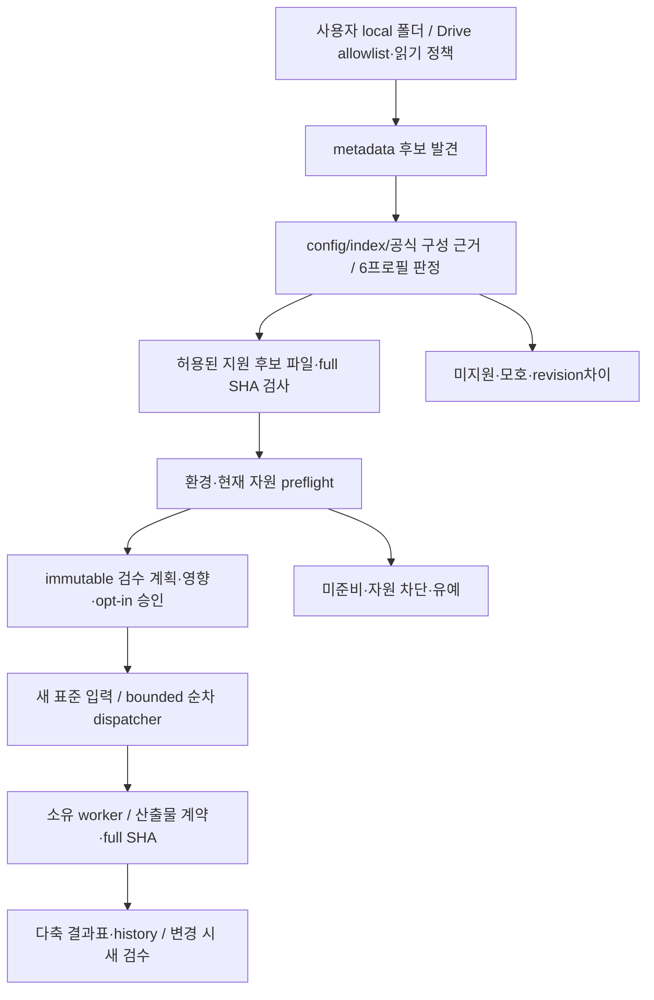
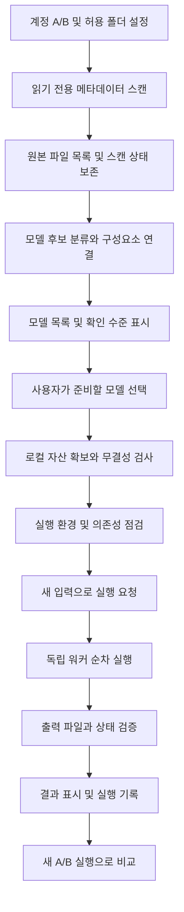
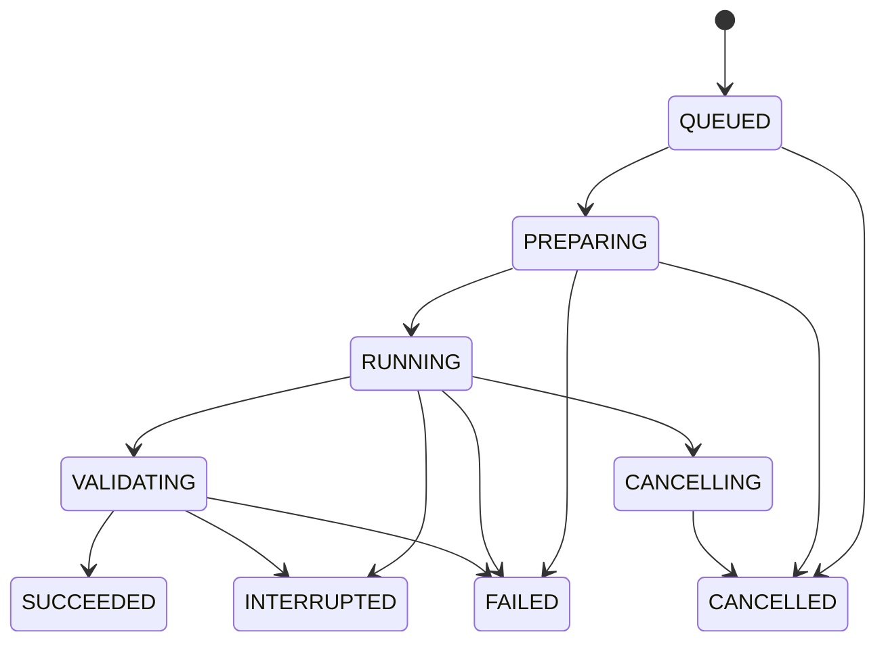

# 데이터 수집부터 실행 비교까지

## M11 이후 자동 검수 흐름 — 신규 설계

현재 수동 선택·요청 중심 흐름을 아래 자동 검수 job으로 연결한다. 상세 정책/상태/재개/검증 기준은 [자동 검수 계획](AUTO_VALIDATION_PLAN.md)을 따른다. 아직 구현·실행 검증 전이다.

6개를 기존 typed queue에 선제 enqueue하지 않는다. 동일 home 공용 슬롯·기존 queue 상한에 맞춰 다음 case만 발행한다. 외부 앱/GPU 전역 독점을 보장하지 않는다. 같은 batch의 새 TTS 24kHz WAV는 명시한 변환 recipe로 Whisper용 16kHz mono PCM16/30초 이하 입력을 새로 만들고 계보/SHA를 연결할 수 있다. TTS가 막히면 STT는 의존 차단 또는 이번 지정 원본 요구 상태이며 과거 WAV·침묵/noise로 fallback해 정상 전사 PASS를 만들지 않는다.

식별 단계의 README/config 명령은 데이터이며 실행하지 않는다. 임의 remote model code/trust_remote_code·무제한 자동 다운로드는 범위 밖이다. 새 snapshot·승인과 현재 자산/환경/code가 다르면 stale로 중단한다. 같은 batch 재개와 새 batch 검수는 구분하고 완료 case를 새 성공으로 재사용하지 않는다.

**아래 P1–P6와 다이어그램은 최초 설계/기존 기능의 역사 계약이다. 위 흐름의 신규 구현 완료를 뜻하지 않는다.**

작성일: 2026-10-16 · 상태: 설계

## 전체 흐름

## P1. 연결과 수집

- 사용자 지정 경로의 겹침·충돌과 출처를 확인한다. 다른 프로젝트/실행의 출력을 입력으로 연결하지 않으며 경로 설정 변경으로 기존 파일을 자동 이동·덮어쓰지 않는다. 같은 실행의 새 중간 결과 전달은 출처 기록 아래 허용한다.
- 각 계정을 별도 인증 항목으로 저장하고 허용 폴더만 탐색한다.
- 페이지네이션을 끝까지 처리한다. 파일 수·폴더 수·오류·스캔 시작/종료를 기록한다.
- 바로가기는 대상 ID를 확인하고 허용 범위 밖이면 따라가지 않는다. 순환 참조와 중복 방문을 막는다.
- API 제한에는 재시도와 지연을 적용하며 인증 실패와 권한 거부를 구별한다.
- 중간 실패 시 “부분 스캔”을 표시한다. 이번 응답에 없는 파일을 삭제로 단정하지 않는다.
- 양 계정에 보이는 같은 공유 파일은 동일 원본으로 연결할 수 있지만, 접근 위치는 각각 보존한다.

**산출물:** scan_id, 범위, 파일 ID·부모·크기·수정 시각·가능한 체크섬, 오류 목록. 개인 목록은 로컬 전용이다.

## P2. 분류와 모델 등록

폴더명을 근거로 모델 종류를 확정하지 않는다. 파일 확장자, config, 가중치 인덱스, 공식 배포 구성과 함께 판단한다. 분류에는 근거와 확신 수준을 저장하고 사용자가 정정할 수 있게 한다.

모델 논리 항목, 버전, 파일, 저장 위치는 분리한다. 같은 이름은 같은 모델의 증거가 아니다. 메타데이터 일치는 중복 후보일 뿐이며 바이트 동일성은 실제 해시로 확인한다.

## P3. 구성과 준비 검증

| 확인 축 | 표시 예 | 의미 |
|---|---|---|
| 발견 | 발견 / 부분 스캔 / 확인 불가 | 저장소에서 메타데이터를 읽었는가 |
| 구성 | 미확인 / 누락 / 충족 | 필수 파일·분할 가중치·기반 모델이 있는가 |
| 무결성 | 미검증 / 일치 / 불일치 | 실제 사용할 바이트를 검증했는가 |
| 런타임 | 미점검 / 준비 가능 / 준비됨 / 차단 | 의존성과 장치가 준비되었는가 |
| 실행 | 미실행 / 최근 성공 / 실패 / 취소 | 특정 버전·환경에서 새 실행을 검증했는가 |

이 축들을 하나의 단순 성공 표시로 합치지 않는다. 버전·파일·환경이 바뀌면 이전 실행 성공은 과거 기록으로 남기고 현재 상태를 재검증한다.

선택 다운로드는 공간 확인 → 임시 파일에 수신 → 길이·해시 확인 → 검증된 위치에 게시 순서다. 중단 파일을 완성 파일로 취급하지 않는다. 사용자 원본과 기존 캐시를 덮어쓰지 않는다.

## P4. 실행 요청

각 요청에 다음 정보를 고정한다.

- run_id, 요청 시각, 모델 버전·가중치 해시.
- 새 입력과 입력 해시, 파라미터, 필요한 전처리.
- 어댑터 버전, 코드 커밋, 패키지 환경, 장치 정보.
- 모델 준비·콜드 로딩 포함 여부, 실행 제한 시간.
- 전용 출력 경로, 취소 및 재시도 정책.

허용된 어댑터만 실행한다. 모델 저장소의 코드를 무조건 실행하지 않는다. 기반 모델 의존성이 해결되지 않으면 외부 다운로드를 자동으로 시작하지 않고 이유를 표시한다.

## P5. 작업과 출력

재시작 시 살아 있는 워커와 작업 소유권을 확인하고, 복구할 수 없는 비종료 작업은 INTERRUPTED로 기록한다. 검증 중 취소는 같은 취소 정책으로 처리하며 결과 게시가 끝나기 전 성공 처리하지 않는다. 실패·취소 후 재시도는 새 run_id를 사용한다.

프로세스 종료 코드만으로 성공을 판정하지 않는다. TTS는 출력 파일 존재·디코딩 가능 여부·샘플레이트·길이·비유한 샘플 여부를 검사하고 UI 재생을 확인한다. 품질 평가는 별도로 기록한다.

## P6. 비교와 보고

- comparison_id 아래 A/B에 각각 새 run_id를 생성한다.
- 동일한 새 텍스트·언어·가능한 공통 화자와 설정으로 순차 실행한다.
- 서로 지원하지 않는 옵션은 숨기지 않고 차이로 표시한다.
- 로딩 시간, 추론 시간, 전체 시간, 출력 오디오 길이를 분리한다.
- TTS의 RTF는 추론 시간 / 생성 오디오 길이로 계산한다.
- GPU 할당 메모리와 장치 전체 사용량, CPU RSS는 서로 구분한다. 수집 실패는 0이 아니라 미수집이다.
- 한 번의 측정을 보편적 성능으로 결론내리지 않는다. 반복 비교 시 각 회차를 새로 실행하고 표본 수·조건을 표시한다.
- 한국어 발음·문장 누락·잡음·선호도는 사람이 평가하며 속도와 섞어 자동 우승자를 만들지 않는다.

## 데이터 관계

- Connection → Scan → SourceFile
- Model → ModelRevision → RequiredComponent
- ModelRevision ↔ SourceFile / LocalAsset
- Run → InputArtifact / OutputArtifact / Environment / Metric / Event
- Comparison → 새 Run A / 새 Run B

런타임 메타데이터와 개인 경로는 로컬 DB에 저장한다. 공개 저장소에는 스키마와 새로 만든 비식별 테스트 자료만 게시한다.
